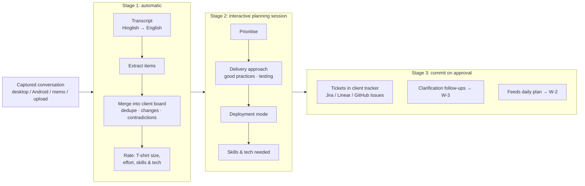

# W-1: Client conversations → client board → delivery plan → tickets

- **Status:** In review
- **Last updated:** 2026-11-19
- **Owner:** founder + Rudra design
- **Related:** [PRD](../prd.md) W-1, F-031–F-035, F-038, F-039 · [ADR-0011 capture](../../adr/0011-conversation-capture.md) · [ADR-0012 consent](../../adr/0012-recording-consent-and-audio-handling.md) · [ADR-0013 STT](../../adr/0013-speech-to-text-provider.md) · [ADR-0007 verification](../../adr/0007-verification-hierarchy.md)

## 1. Purpose
After every client conversation, the developer should have, without manual work:
- a complete, rated picture of everything the client asked for,
- a place to think through *what to build first and how to deliver it well*,
- tickets in the client's tracker only for what was agreed.

Nothing discussed is lost, and every item can be traced back to what the client actually said.

## 2. The three stages

### Stage 1: Brainstorm board (automatic, right after the call)
1. **Transcribe** both tracks (ADR-0013). Output in English, with original-language quotes kept for citations.
2. **Extract items** from the transcript. Each item has a type (§3) and at least one **citation** (timestamp + quote).
3. **Merge into the client's board:**
   - match against existing items (same feature discussed again),
   - detect **changes** ("client now wants X instead of Y") and **contradictions** with earlier calls,
   - never silently overwrite: changes are recorded as new versions with citations to both calls.
4. **Rate each item:**
   - **Complexity:** T-shirt size `XS / S / M / L / XL` (XL = must be split).
   - **Effort breakdown:** separate T-shirt sizes for **dev / test / deploy**.
   - **Skills & tech needed** (e.g. "payment gateway integration", "Redis", "Flutter").
   - **Confidence** of the rating, plus the reasons (assumptions).
5. **Analyse the whole conversation:**
   - **Blind spots:** what wasn't discussed but should have been (edge cases, error handling, security, performance, data migration, non-functional needs, dependencies, missing acceptance criteria).
   - **Clarification questions:** what must be confirmed with the client, each tied to items.
   - **Deadlines and commitments** mentioned by either side.
6. **Notify** in the digest, or immediately if the user prefers: "Call with *Client X* processed: 7 new items, 2 changes, 1 contradiction, 5 questions."

### Stage 2: Planning session (interactive, user + Rudra)
A conversation on top of the board (web app only in MVP). Rudra proposes; the user decides.
1. **What to pick first:** proposed order by value, effort, deadline and dependencies, with reasoning. The user reorders.
2. **How to deliver it well**, per item or group:
   - implementation approach,
   - good practices that apply: tests to write, code review, feature flags, backward compatibility, migrations, observability,
   - testing strategy: unit / integration / UAT,
   - risks.
3. **Deployment mode:** environments, CI/CD path, rollout strategy (flag / staged / big-bang), rollback plan, client sign-off points.
4. **Skills & tech:** what the work requires, what's new or unknown to the user, and (later, from git history) who on the team knows it.
5. **Result:** a **delivery plan** (ordered items, milestones, approach notes) saved on the board. Items not planned are explicitly **deferred** with a reason.

### Stage 3: Commit (on approval)
1. Rudra drafts tickets for planned items in the **client's tracker format** (title, description, acceptance criteria, size, labels, due date as configured per client).
2. The user approves or edits; Rudra creates the tickets (stage → audit → commit).
3. Clarification questions become follow-up drafts (W-3).
4. Committed items with deadlines feed the daily plan (W-2).
5. **Client sign-off (optional, F-040):** Rudra generates a clean "requirements we discussed" summary (items, decisions, open questions, deadlines) that the user reviews and sends to the client themselves (email/Slack/PDF). The client's confirmation, or later corrections, is recorded on the board. Rudra never contacts the client directly and stays invisible.

## 3. Board item model (product level; the data design refines it)

| Field | Notes |
|---|---|
| Type | `requirement`, `change`, `bug`, `question`, `decision`, `constraint` (non-functional, budget, deadline), `risk` (blind spot), `action` (someone must do something) |
| Title, description | Written by Rudra, editable |
| Citations | One or more: conversation, timestamp range, quote (original language + English) |
| Complexity | T-shirt `XS–XL` + confidence + assumptions |
| Effort | T-shirt per phase: dev / test / deploy |
| Skills & tech | Tags |
| Dependencies | Other items |
| Deadline | If stated, with citation |
| Priority / order | Set in stage 2 |
| Delivery notes | Approach, practices, deployment mode (stage 2) |
| Status | `new → discussed → planned → committed (ticket link) → done` · `deferred` · `dropped` |
| History | Every change, with the call that caused it |

**T-shirt calibration:** sizes mean different things to different people. Each user gets a calibration (e.g. S ≈ up to half a day). It starts from defaults, and Rudra refines it from how long committed items actually take (W-4 groundwork).

## 4. Success contracts (what Rudra verifies)

| Stage | Checks | Layer (ADR-0007) |
|---|---|---|
| 1 | Every item has ≥ 1 citation that exists in the transcript (no invented items) | Deterministic |
| 1 | Coverage: transcript segments classified as client asks are each linked to an item or marked "no item" (chit-chat) | Deterministic + judge |
| 1 | Every detected change or contradiction links to both source conversations | Deterministic |
| 1 | Every item has a size, effort breakdown and skills (or an explicit "unknown" with a question raised) | Deterministic |
| 1 | Ratings and blind spots are plausible | LLM judge (different model family) + user feedback |
| 2 | Every board item is planned, deferred (with reason) or dropped, with none left untriaged | Deterministic |
| 3 | Every approved ticket exists in the right tracker/project with the configured fields; it links back to the board item; the due date matches the plan | Deterministic (tracker read-back) |
| 3 | Nothing created outside the approved set | Deterministic + security layer |

## 5. Corner cases

| # | Case | Handling |
|---|---|---|
| 1 | Call not linked to any client (unknown number, no calendar) | Ask the user once: "Which client?" Learn the mapping. |
| 2 | Internal call relaying a client change (PM → developer) | Processed like a client call; items marked "relayed by" with the speaker |
| 3 | Same feature discussed across many calls | Merge into one item; history shows each mention |
| 4 | Client contradicts an earlier call | Flag as a contradiction with both citations; becomes a clarification question |
| 5 | Partial capture (dropped call, late start) | Stitch segments; mark the board "partial capture" with gap times |
| 6 | Memo-only (phone call not captured) | Items extracted from the memo; citations point to the memo; lower confidence |
| 7 | Several client speakers | Remote-track diarization; items attributed to "client side" when the speaker is unclear |
| 8 | Hinglish / poor audio | Quotes kept in the original; low-confidence segments flagged for review |
| 9 | Screen share showing a design | Audio only in MVP; a hotkey screenshot attaches to the conversation |
| 10 | Notes-only mode (no consent) | Only the user's mic is processed; the board notes that client speech wasn't captured |
| 11 | Sensitive data spoken | Redacted from transcript and items before analysis |
| 12 | Non-work or personal call | Never processed (ADR-0012 gating) |
| 13 | Item already exists as a ticket in the client's tracker | Linked, not duplicated; changes proposed as ticket updates |

## 6. Open questions
1. Default T-shirt calibration values.
2. ~~Client-shareable summary?~~ **Resolved:** yes, client sign-off summary (F-040), sent by the user.
3. What goes wrong most today after calls? Pending founder input. Default assumption: forgotten requirements, unclear scope, unrecorded deadlines, and clients changing things later.
4. ~~Planning session on Android?~~ **Resolved:** web only in MVP.
