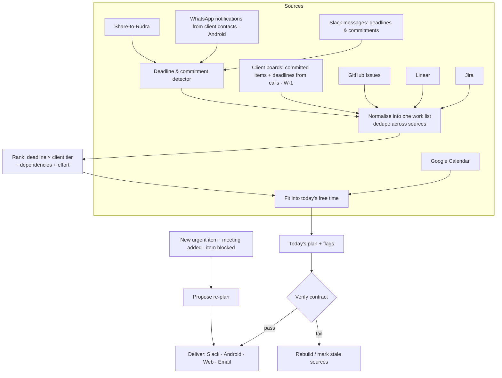

# W-2: Daily plan across trackers

- **Status:** In review
- **Last updated:** 2026-11-20
- **Owner:** founder + Rudra design
- **Related:** [PRD](../prd.md) W-2, F-029, F-034, F-041, F-042 · [W-1](w1-client-conversations.md) · ADR-0007

## 1. Purpose
Every morning the developer gets one trustworthy answer to "what do I work on today, for which client, and in what order?". It covers everything they owe, wherever it was recorded: trackers, calls, Slack, WhatsApp. It ranks by deadline and client importance, fits the plan into the real free time around meetings, and re-plans with their approval when something urgent lands.

## 2. Decisions so far (founder input, 2026-11-19/20)
| Topic | Decision |
|---|---|
| Ranking factors | **Nearest deadline + client importance** |
| Client importance | Three tiers per client: **High / Normal / Low** (set in the client registry, F-034) |
| Delivery | **Slack DM, Android notification, web "Today" page, email.** User enables any subset; notification cap applies. |
| Re-planning | **Propose a new plan, user approves** (shows what moves out) |
| Deadline sources | **Tracker due dates, said in calls, Slack messages, WhatsApp messages** |
| WhatsApp messages | **Android notification reader** (client contacts only) + **share-to-Rudra** as backup |

## 3. Flow



## 4. Inputs

### 4.1 Work items (F-029 unified view)
Everything **assigned to the user** and open, normalised to one shape:

| Field | Notes |
|---|---|
| Source | Jira / Linear / GitHub Issues / client board |
| Client | From the project → client mapping (set at onboarding) |
| Title, link | Back to the source |
| Status | Normalised: `todo / in_progress / blocked / in_review` |
| Due date | From the tracker, or a **shadow deadline** (below), with its source |
| Size | T-shirt from W-1 rating, the tracker's estimate, or unknown |
| Dependencies / blocked-by | From the tracker links or the board |

### 4.2 Shadow deadlines and commitments
Deadlines that exist only in conversations or chats:
- **From calls:** W-1 board items with deadlines (cited).
- **From Slack:** messages in the user's DMs and channels such as "need this by Friday" (client or PM ask), or the user's own "I'll send it tomorrow" (a **commitment** the user made).
- **From WhatsApp:** client-contact message notifications on Android, plus shared messages.

Each shadow deadline keeps its **evidence** (message/quote/link, time, sender) and is matched to a work item. If none matches, it becomes a new item: "Unticketed request from Client X". Rudra offers to **write it into the real ticket** (stage → audit → commit), so deadlines stop living only in chats.

### 4.3 Capacity
- Calendar events (meetings) for today.
- Working hours (set by the user) minus meetings, with a buffer for interruptions (default 20%).
- **T-shirt calibration** (shared with W-1) converts sizes into hours.

## 5. Ranking (deterministic and explainable)
Ranking is **rule-based code, not an LLM decision**, so it is predictable, testable and verifiable. The LLM only writes the human-friendly explanation.

1. **Hard first:** overdue items, then items due today.
2. **Score** the rest:
   `urgency(days to deadline) × tier_weight(High 1.5 · Normal 1.0 · Low 0.6)`, with blocked items excluded from the plan and listed separately.
3. **Dependencies:** an item that unblocks others moves ahead of them.
4. **Tie-breaks:** in-progress before new (finish what's started), then smaller effort.
5. **Fit:** take items in rank order until today's capacity is full. Big items get a time block; the rest go to "if time permits".

Weights are configurable per user. The plan shows *why* each item is where it is ("due tomorrow · High-tier client").

## 6. Output: today's plan
```
Today — Thu 20 Nov  ·  5h 30m focus time (3 meetings)
⚠ Overdue (1)      PHX-142 Payment retry bug — Client Phoenix (High) — due yesterday
1. 10:00–12:00     ACME-88 Export to CSV — Acme (High) — due tomorrow · M
2. 14:00–15:30     #231 Fix login redirect — Nova (Normal) — due Fri · S
3. If time permits LIN-12 Update docs — Nova (Normal) — due next week · XS
⛔ Blocked (1)     ACME-90 waiting on API keys from client → [Ask for help / follow up] (W-3)
📝 New from chats  "Need the report by Monday" — Acme, WhatsApp 09:12 → [Add to ticket ACME-91?]
⚠ At risk          Next week: 3 L-items for Phoenix exceed capacity → [Draft renegotiation message?] (W-3)
```

## 7. Re-planning
**Triggers:**
- a new urgent item (from W-1, Slack, WhatsApp or a tracker),
- a meeting added or removed,
- an item becomes blocked or unblocked,
- the user marks an item done early.

**Behaviour:** Rudra proposes a new plan and shows what moved out and why. The user approves, edits or ignores it. Max one re-plan prompt per 2 hours, unless an item is due today.

## 8. Success contract (verified before delivery, ADR-0007)
| Check | Layer |
|---|---|
| **Completeness:** every open item assigned to the user in every connected tracker appears in the plan, is deferred (with a reason) or is listed as blocked | Deterministic (re-query trackers) |
| **No ghosts:** every item in the plan exists and is open at delivery time | Deterministic |
| **Order:** overdue and due-today items come first; the ranking matches the scoring rules | Deterministic |
| **Capacity:** planned time ≤ available focus time | Deterministic (calendar) |
| **Shadow deadlines:** every detected deadline cites its evidence (message/quote) and is matched or flagged as unticketed | Deterministic |
| **Freshness:** every source synced within the last N minutes, or the plan shows "Jira data is 3 h old" | Deterministic |

## 9. Corner cases
| # | Case | Handling |
|---|---|---|
| 1 | Same task in two places (Jira ticket + GitHub issue) | Dedupe by links and similarity; ask once if unsure; remember |
| 2 | Item with no due date | Ranked after dated items by tier and age; suggest a date if old |
| 3 | Shadow deadline conflicts with the tracker date | Show both with evidence; ask which is right; offer to update the ticket |
| 4 | Client in another time zone ("by EOD") | Interpret in the client's time zone (stored on the client); show in local time |
| 5 | Capacity overflow (more due than time) | Show what can't fit; propose re-ordering or a renegotiation draft (W-3) |
| 6 | Tracker API down / token expired | Plan from cached data, marked stale, plus a reconnect prompt |
| 7 | Leave, holiday, weekend | No plan on days off (calendar or settings); deadlines inside leave flagged in advance |
| 8 | Item assigned to the user but actually someone else's | "Not mine" action; Rudra stops including it and offers a reassignment note |
| 9 | Ambiguous chat message ("can you check this soon?") | Detected as a request without a deadline; low confidence, shown under "New from chats" for the user to confirm |
| 10 | WhatsApp message read on another device (no notification) | Not seen; share-to-Rudra backup. Coverage limitation stated in settings |
| 11 | Very large backlog (50+ items) | Plan shows the top items for today plus counts; the full list is on the web page |
| 12 | Multiple assignees on one ticket | Included with a "shared" tag; the user can opt out per item |

## 10. Privacy notes
- The Android notification reader only processes notifications from contacts the user marked as clients (or explicitly enabled chats). Everything else is ignored on-device and never uploaded.
- Slack reading uses the minimum scopes; only messages detected as requests, deadlines or commitments are stored, with their quote.
- Consent and retention rules follow ADR-0012 (message content from clients is treated like conversation content).

## 11. Defaults (accepted 2026-11-20, all user-configurable)
- Morning plan at **09:00 local time** (or 30 minutes before the first meeting if that is earlier).
- Working hours **10:00–19:00**, interruption buffer **20%**.
- The user's own Slack commitments are **tracked by default** (can be turned off).

## 12. Open questions
1. Desktop equivalent of the notification reader for WhatsApp Desktop on Windows (to be verified in the HLD phase).
