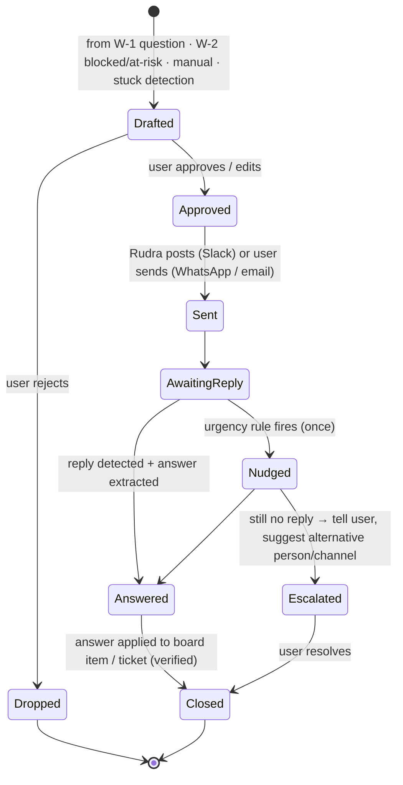

# W-3: Follow-ups, open loops and help requests

- **Status:** In review
- **Last updated:** 2026-11-20
- **Owner:** founder + Rudra design
- **Related:** [PRD](../prd.md) W-3, F-042, F-043, F-044, F-045 · [W-1](w1-client-conversations.md) · [W-2](w2-daily-plan.md) · ADR-0007, ADR-0008, ADR-0012

## 1. Purpose
Nothing the developer is waiting on should fall through the cracks:
- client clarifications,
- missing inputs (API keys, designs, credentials),
- review requests,
- decisions from the PM,
- answers from teammates.

Rudra drafts the message, sends it (as the user, after approval) or hands it to the user to send, **tracks the reply**, nudges at the right time, and **feeds the answer back** into the client board or ticket. When the developer is stuck, Rudra finds who can help and drafts a clear, complete help request, ideally *before* the developer has lost a day struggling alone.

## 2. Decisions so far (founder input, 2026-11-20)
| Topic | Decision |
|---|---|
| Recipients | Teammates (Slack), PM / tech lead (Slack), clients (WhatsApp), clients (email) |
| Sending | **Rudra sends as the user after approval** on Slack; autonomy can grow per workflow via the trust ladder. **Client messages are always sent by the user**, never by Rudra directly. |
| Nudging | **Urgency-based:** due today → after 2 h; due this week → next working day; otherwise → after 2 days. Max one automatic nudge per loop. |
| Getting help | The user asks a specific senior, posts in a team channel, searches history, or struggles alone first. Rudra supports all four and **detects being stuck**. |

## 3. Core concept: the open loop
Every follow-up is an **open loop**: something the user is waiting on, with an owner, a channel, a deadline and evidence.

**Loop sources:**
- W-1 clarification questions,
- W-2 blocked items, at-risk deadlines and renegotiation drafts,
- commitments others made to the user ("I'll send the keys tomorrow"),
- manual "follow up on this",
- stuck detection (§6).

## 4. Channels

| Channel | Send | Reply detection | Notes |
|---|---|---|---|
| **Slack** (teammates, PM) | Rudra posts **as the user** (user token) after approval, in the right DM or thread | Slack events: replies in the thread or DM | Full automation; trust ladder can later allow auto-send for low-risk nudges |
| **WhatsApp** (client) | Android app opens WhatsApp with the **message pre-filled** for that contact; **the user taps send** | **Android notification reader (F-042)** detects the client's reply | Personal WhatsApp has no send API, which also matches "client messages are sent by the user" |
| **Email** (client) | Rudra opens a **pre-filled compose** in the user's mail (no mailbox access needed); the user sends | ⚠️ Needs mailbox read access, which Google classes as a restricted scope (security assessment). MVP: the user marks "answered", or forwards the reply to Rudra. Full detection later. | See decision D-1 |

## 5. Message quality rules
Every draft follows the same discipline, whatever the channel:
- **One clear ask** per message, with **why** and **by when**.
- **Context included:** links to the ticket, board item, PR or call moment; the minimum needed to answer without a meeting.
- **Tone learned from the user** (style learning, F-012). Client messages are more formal; teammate messages are short.
- **Language:** English by default. Hinglish allowed for teammates if the user writes that way.
- **No secrets:** credentials, tokens and personal data are redacted from drafts, including from pasted logs.

## 6. Getting help

### 6.1 Expert finder (F-044)
For a blocked item or a question, rank who is most likely to know:
- **Code ownership:** recent authors and reviewers of the files and modules involved (git history, CODEOWNERS).
- **Ticket history:** who resolved similar tickets.
- **Slack history:** who answered similar questions.
- **Availability:** Slack status, calendar, time zone. Never suggest someone on leave or asleep.

Ranking is deterministic scoring with the evidence shown ("Priya wrote 70% of `payments/retry.ts` in the last 3 months"). The user picks: **ask a person** (DM) or **ask the team channel**.

### 6.2 Help request draft
A good help request answers the helper's questions up front:
1. What I'm trying to do (item + client context).
2. What's happening (error, behaviour) with the redacted log snippet.
3. What I've tried.
4. The specific ask and the time needed ("15 min pairing?").
5. Links: ticket, PR, branch, relevant files.

### 6.3 Stuck detection (F-045, gentle and opt-out)
Signals that the user may be stuck on an in-progress item:
- no commits or PR activity for longer than the item's size suggests (e.g. an S item idle for a full day),
- status `blocked` set in the tracker,
- the same error searched or discussed repeatedly (from Slack).

Rudra **offers** help ("ACME-90 has had no progress for a day. Want me to find who knows the payments module?"). It never posts on its own; it respects the notification cap, and the user can switch it off. **It never reports stuck time to anyone else** (ADR-0003 spirit: no monitoring).

## 7. Answer feedback
When a reply arrives, Rudra extracts the answer and proposes where it goes:
- answer to a W-1 question → update the board item (with a citation to the message) and mark the question resolved,
- input received (e.g. API keys arrived) → unblock the item; W-2 re-plans,
- a new deadline in the reply → shadow deadline (W-2).

Replies are **untrusted content** (ADR-0008). They can update loop state and propose board changes for user approval, but they can never trigger sends, new recipients or tool actions.

## 8. Success contract (ADR-0007)
| Check | Layer |
|---|---|
| The sent message equals the approved draft (content hash) | Deterministic |
| Recipient and channel equal the approved ones; recipient is a workspace member or a registered client contact | Deterministic + provenance gate (ADR-0008) |
| Links in the message resolve | Deterministic |
| Message actually exists in the Slack thread/DM after sending (read-back) | Deterministic |
| No client message was sent by Rudra itself | Deterministic (policy) |
| No secrets or personal data in drafts | Deterministic (secret/PII patterns) |
| Nudge sent at most once, only after the urgency rule fired, and within the recipient's working hours | Deterministic |
| Answer applied to the right board item or ticket, with a citation to the reply | Deterministic + user approval |

## 9. Corner cases
| # | Case | Handling |
|---|---|---|
| 1 | Answer comes on a different channel (asked on Slack, answered in a call) | W-1 extraction matches the answer to the open loop and proposes closing it |
| 2 | Partial answer | Loop stays open with the remaining part; a follow-up is drafted |
| 3 | The user already followed up manually | Detect the user's own message in the thread or chat; don't nudge; update the loop |
| 4 | Recipient on leave / out of office | Suggest the next-best person (expert finder) or wait until they return |
| 5 | Recipient's time zone | Nudges are only sent in the recipient's working hours (the client's time zone comes from F-034) |
| 6 | Group chat (client WhatsApp group, Slack channel) | Loop tracks replies from any of the expected people; asks the user if unclear |
| 7 | Reply in Hinglish or a voice note | Text: handled. WhatsApp voice notes: user shares them to Rudra (transcribed like a memo) |
| 8 | Recipient left the company / contact invalid | Escalate to the user with a suggested alternative |
| 9 | Several loops to the same person | Batch them into one message where possible (fewer interruptions) |
| 10 | Sensitive content in pasted logs | Redact before drafting; show the user what was removed |
| 11 | Client asks a question back | New loop for the user ("Client asked: …"), shown in the W-2 plan |

## 10. Open questions
- ~~D-1: client email in MVP~~ **Resolved (2026-11-20): option A for MVP.** Pre-filled compose + manual "answered" / forward-to-Rudra. Full Gmail reply detection (restricted scope + security assessment) later.
- Trust-ladder thresholds for auto-sending teammate nudges.
- Should batching (§9 #9) be the default?
